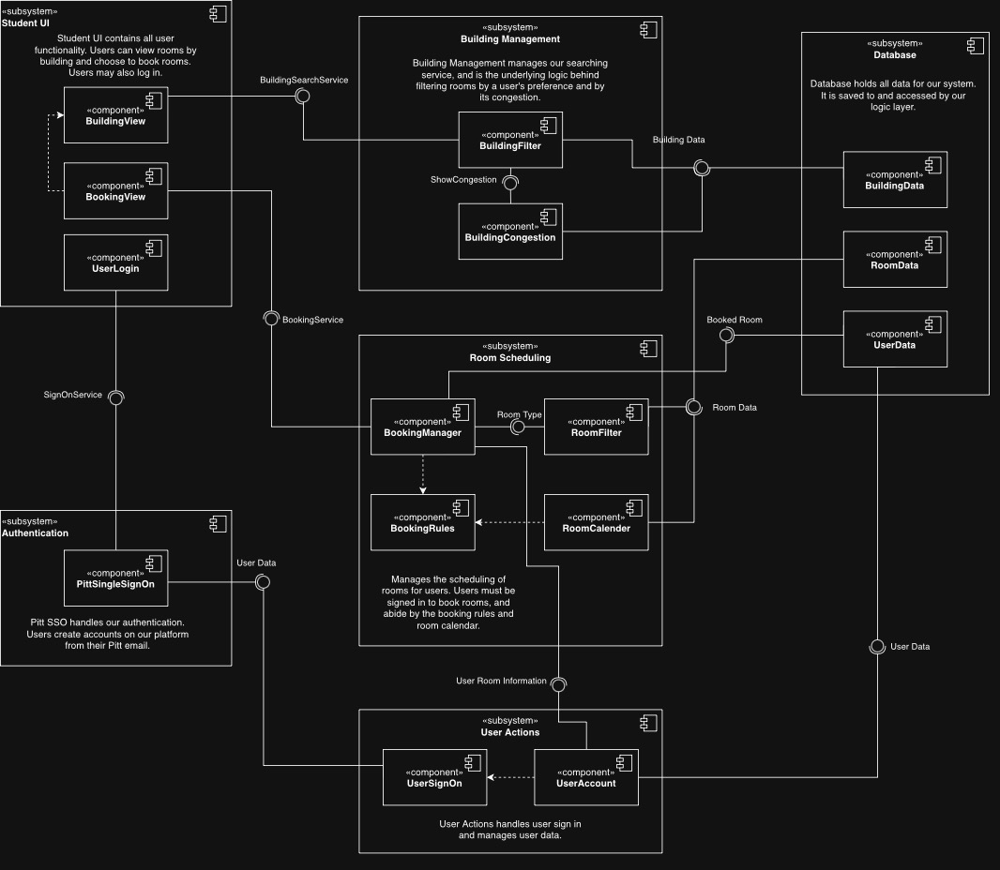
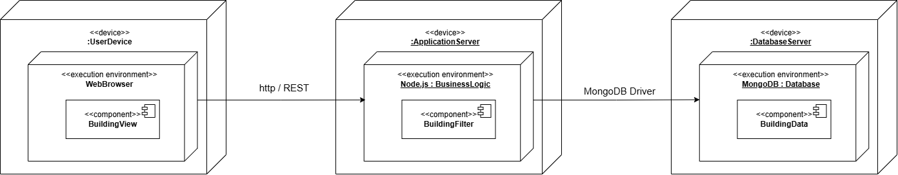

# Seat Saver 
A repository for our 1530 Project, Seat Saver. Seat saver is meant to help Pitt students find ppen study spaces around campus, whether that be an open space or private room. 

Team Members:
- Erik Lehmann (eml249@pitt.edu)
- Noah Schaab (nms170@pitt.edu)
- Jared Young (jjy23@pitt.edu)
- Jack Carfrey (jac961@pitt.edu)
- Thanh Mai (btm100@pitt.edu) 

## Tech stack

| Layer | Technology | Why we're using it |
| --- | --- | --- |
| Languages | JavaScript,  HTML/CSS, SQL | HTML and CSS are basically required for frontend development, and some members have experience in it, JavaScript allows us to limit the amount of languages we are using by implementing Node.js. |
| Frontend | React.js | Some team members have experience, and it has good documentation and is easy to deploy. It also has good performance and should easily be able to match the 5 second response time requested in the Sprint 3 design goal. |
| Backend | Node.js | We have people who have used it and want to learn it. It also allows us to focus on just JavaScript for the front and back end instead of having to switch to another language like python or java. |
| Database | MongoDB | Learned about this program in class, some members are willing to learn it for the project. It also meets our security requirements from the sprint 3 design goals, with good authentication and security customization allowing for different accounts with different access levels that can be created and maintained.  |
| External Services (planned) | Pitt EMS API or Pitt API if we can get permission. | They have data that would be useful to us. |
| Deployment / Hosting (planned) | BunX (team's proposed option) | Easy way to host a website, Jared learned it during steelhacks this year. This may be implemented later as we do not need it at the moment. |

The current code does not use BunX, but may be implemented in the future. 

## Architecture 
### Subsystem Decomposition

### Deployment Diagram 

### Repository Structure 
The viewer's `features/buildings/` folder (most) corresponds to Building Management and Student UI. 
Its server and database model support the Database subsystem. 
The other planned subsystems have yet to be implemented. 

## To Run The Skeleton
### Prerequisites 
- Node.js v24.14.0
- npm 11.9.0

### 1. Clone the repository 
```bash
git clone https://github.com/eml249/1530-Crumbs.git
cd 1530-Crumbs
```

### 2. Configure the viewer's environment 
From the root of the repository, copy the environment file. 
```bash
cd viewer
cp server/.env.example server/.env
```
The copied file should contain the following:
```dotenv
# create a new file called ".env" with the password xEWD4vRoNpuatDUe filled in in place of the <password> and the comments removed
READ_MONGODB_URI="mongodb+srv://readUser:<password>@crumbs1530.9q4u14v.mongodb.net/test?retryWrites=true&w=majority"
PORT=5001
```
The `<password>` segment should be filled in with the given password provided by the group. (The currently provided password is for a dummy account that will be removed later)
### 3. Install Dependencies 
While still inside `viewer/`, run: 
```bash 
npm run setup
```
This should install the needed dependencies for `viewer/server/` and /`viewer/client/`. 
### 4. Start the Viewer 
Run: 
```bash
npm run dev
```
This starts both the viewer backend and frontend simultaneously, and usually runs on **http://localhost:5174** in a web browser. The backend should be running on **port 5001.** The terminal must remain open while using the viewer, and can be terminated using **Ctrl+C**. 
### 5. Confirm It's Running 
Open **http://localhost:5174** and ensure you see the Buildings page. You may browse the buildings and rooms and filter them. 

## Current Features:
### In viewer:
 - View Buildings
   - Allows you to view study spaces on the Pitt campus and filter them by classification (e.g. Dorm Hall, Academic Building). To view these study spaces/buildings, click on the "Buildings" tab on the top of the screen and scroll down to see the list of spaces as well as filter buttons to sort out preferences.
 - View Available Rooms
   - In the previously mentioned buildings, View Available Rooms means you can sort rooms by capacity and congestion (Currently a mix of placeholder and non placeholder sources, noted in each entry). To view available rooms, click on the rooms tab at the top of the screen. Use the filter buttons to view the desired room types you want to see. You can also view rooms by building if you click on the "Rooms by Building" tab at the top of the screen. You can use the filter buttons to view desired buildings and see the room information associated with the building.
 - View Database JSON Files
   - This feature allows you to view the data of the buildings and rooms. To view the database, click the "Database" tab at the top of the screen. You can see a table of the data as well as the raw JSON file.
 - View Booking Details
   - View Booking Details allows you to look at the booking you’ve made with an account and other information pertaining to the space you booked. To view booking details, you can click on the “My Booking” tab on the top of the screen. You will be met with a sign in screen with example accounts to use for the purpose of the demo. Clicking “fill in” by one of the accounts then clicking “sign in” will take you to the bookings. Each booking is listed with the hours it's booked, the length of time it's booked for, the room number, location, and capacity. There is a sign out button in the top right corner to exit the account. 
 - Cancel Booking Button
   - The Cancel Booking Button is a part of the a Cancel Booking feature still being worked on. It is the button attached to each booking panel to give you the option to cancel. To cancel a booking, you can click the cancel booking button in the top right corner of the booking panels after signing in with your account. After clicking that button, you will get a confirmation screen to confirm you want to cancel the booking. Currently for the demo, the booking does not actually cancel and still stays in your account regardless.
 - Filter Preferences
   - Filter Preferences is a feature that allows you to view rooms and buildings based on different criteria. To filter preferences, you can look at the main screen after the website loads. Under the title listed “Campus Building Directory” you can click on five tabs to filter out and view certain buildings. Click on a building filter to view the buildings you want.

## Acknowledgements 
Generative AI was used as a code assistant while developing our systems.

